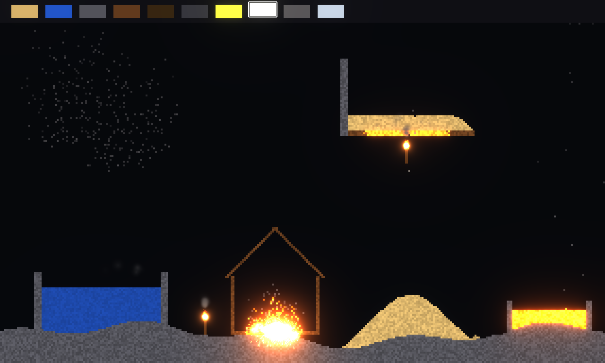
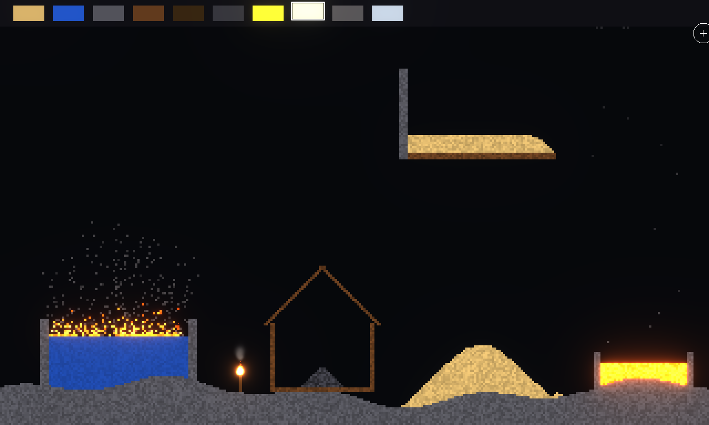
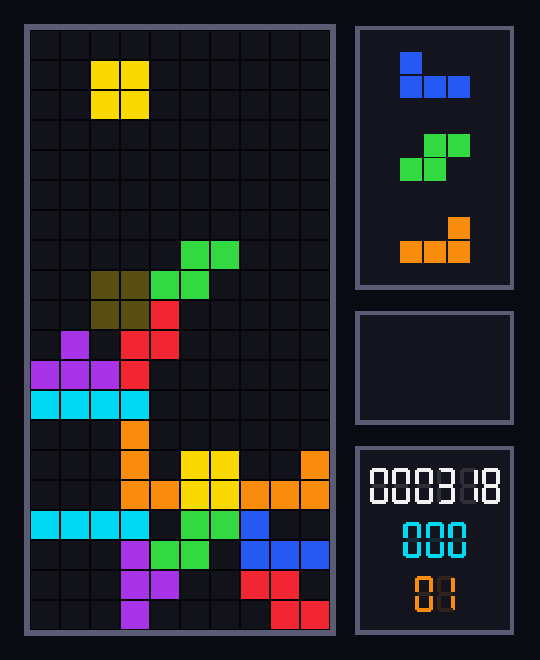
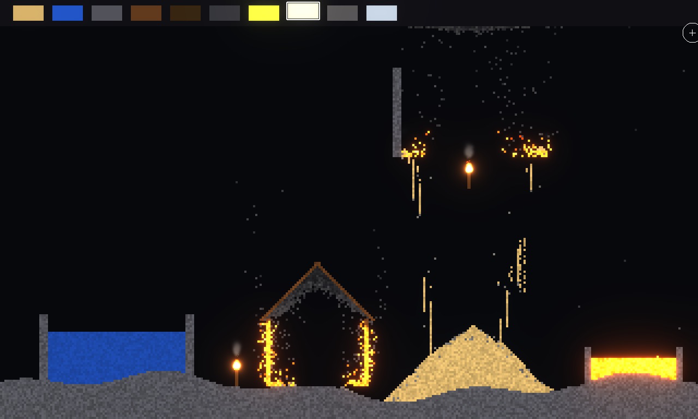

# MapleEngine
2D Game Engine with ECS. The engine uses Box2D for physics and OpenGL for rendering.



## Installation:
Install required dependencies:
- Ubuntu/Debian: `apt install build-essential cmake libgl-dev libglm-dev libglew-dev libglfw3-dev`
- Arch/Manjaro: `pacman -S base-devel cmake glut glm glfw glew`

Audio uses [miniaudio](https://miniaud.io). If it is installed (so that
`pkg-config miniaudio` finds it) that copy is used; otherwise CMake downloads
miniaudio 0.11.25 and builds it with the engine.

Clone the repository:

```
git clone https://github.com/anteroul/MapleEngine.git
cd MapleEngine
```

The engine uses the Box2D 3.x C API (`b2WorldId`, `b2CreateWorld`, ...), so the
2.4 packages most distributions ship will not work. Build and install Box2D 3
from the bundled submodule:

```
git submodule update --init --recursive
cmake -S 3rd_party/box2d -B 3rd_party/box2d/build -DCMAKE_BUILD_TYPE=Release \
      -DBOX2D_SAMPLES=OFF -DBOX2D_UNIT_TESTS=OFF -DBOX2D_BENCHMARKS=OFF
cmake --build 3rd_party/box2d/build
sudo cmake --install 3rd_party/box2d/build
```

Then build the engine:

```
cmake -S . -B build
cmake --build build
./build/MapleEngine
```

## Physics

Simulation is Box2D's, not the engine's. The world carries real gravity, and
the solver owns gravity, contacts, friction and restitution. `World::update`
steps that world exactly once per frame on a fixed 1/60 s timestep, and the
result is copied into each entity's `transform` afterwards.

Entities pick how they are simulated when they are created:

```cpp
// never moves: terrain, walls
new Entity(world, topLeft, bottomRight, BodyType::Static);

// moved by script, pushes dynamic bodies, ignores gravity
new Entity(world, topLeft, bottomRight, BodyType::Kinematic);

// fully simulated
new Entity(world, topLeft, bottomRight, BodyType::Dynamic);
```

Surface properties come from a `PhysicsMaterial` passed alongside, and a
`RigidBody` component gives the entity a mass plus the gameplay-facing calls:
`applyForce`, `applyImpulse`, `getVelocity`, `isGrounded`.

Components must never move a simulated body with `b2Body_SetTransform`, which
teleports it past whatever is in between: write a force or a velocity and let
the solver move it.

### Tests

The tests are headless, so they need no display:

```
cmake --build build
ctest --test-dir build --output-on-failure
```

Configure with `-DMAPLE_BUILD_TESTS=OFF` to skip them.

## Scenes

A game hands the engine a function that builds its scene, and can choose
which part of world space the camera shows:

```cpp
void createMyScene(World& game)
{
    game.setView(-1.f, 17.f, -1.f, 21.f);  // letterboxed, aspect preserved
    game.addEntity(new Entity(...));
}

int main()
{
    App app(540, 660, "My Game", false);
    World::getInstance().setScene(createMyScene);
    app.Launch();
}
```

`World::addEntity()` and `World::destroyEntity()` are safe to call from inside
a component's update: both take effect at the end of the current update.

## Bloom and glow

Bloom is off by default. Turned on, the scene is drawn into a floating point
buffer, and whatever is brighter than the threshold spills light around it:

```cpp
BloomSettings bloom;
bloom.enabled = true;
bloom.threshold = 1.f;   // only colours brighter than white bloom
bloom.intensity = 1.f;
game.setBloom(bloom);

renderer->setColour({4.f, 1.5f, 0.5f});  // brighter than white: blooms orange
```

A `Glow` component makes one entity shine however bright it is drawn, in its
own colour or in one of its own:

```cpp
#include "ECS/Components/Glow.h"

entity->addComponent(new Glow(*entity, 1.5f));                      // own colour
entity->addComponent(new Glow(*entity, glm::vec3{0.4f, 0.8f, 1.f}, 3.f));
```

Bloom needs OpenGL 3.0. Without it the engine prints a warning and draws the
scene as before.

## Fire and smoke

`Effects/ParticleEffects.h` has ready-made particle effects: `fire`, `smoke`,
`embers`, `sparks` and `explosion`. Each takes the width of the effect in
world units and scales the rest to match. Fire, embers and sparks are brighter
than white, so they glow with bloom on.

Attach one to an entity with a `ParticleEmitter`:

```cpp
#include "ECS/Components/ParticleEmitter.h"
#include "Effects/ParticleEffects.h"

// Components draw in the order they are added: smoke first, so the flame
// shows through it.
torch->addComponent(new ParticleEmitter(*torch, effects::smoke(0.4f), {0.f, 0.3f}));
torch->addComponent(new ParticleEmitter(*torch, effects::fire(0.3f)));
```

or drive a `ParticleSystem` yourself, for one-off bursts:

```cpp
ParticleSystem sparks(effects::sparks(0.5f));
sparks.burst({x, y}, 40);   // then sparks.update(dt) and sparks.render() each frame
```

Every number in a `ParticleEffect` can be changed, so a preset is only a
starting point: green fire is `fire()` with different colours.



## Audio

`Audio::getInstance()` plays sound effects fire-and-forget, plus one looping
music track. Sounds can come from files (WAV, FLAC, MP3) or be generated in
code with the chiptune synthesizer in `src/Audio/Synth.h`, so a game needs no
audio files at all:

```cpp
#include "Audio/Audio.h"
#include "Audio/Synth.h"

// A short rising blip.
auto jump = synth::share(synth::render({{synth::Waveform::Square, 400.f, 800.f, 0.1f}}));
Audio::getInstance().play(jump);

Audio::getInstance().play("sounds/explosion.wav", 0.8f);
Audio::getInstance().playMusic("music/theme.mp3", 0.5f);
```

If no audio device can be opened, the engine prints a warning and every call
does nothing, so games never need to check first.

## Maple Tetris

`games/tetris` is a Tetris clone built on the engine. It follows the modern
guideline: SRS rotation with wall kicks, a 7-bag randomiser, hold, a
three-piece preview, a ghost piece, lock delay and guideline scoring. Cleared
rows break up into Box2D bodies that tumble off the board.



```
./build/MapleTetris        # or: nix run .#tetris
```

| Key                    | Action                      |
|------------------------|-----------------------------|
| Left / Right, A / D    | Move                        |
| Down, S                | Soft drop                   |
| Space                  | Hard drop                   |
| Up, X, W               | Rotate clockwise            |
| Z, Ctrl                | Rotate counter-clockwise    |
| C, Shift               | Hold                        |
| P                      | Pause                       |
| R                      | Restart                     |
| M                      | Music on / off              |
| Esc                    | Quit                        |

All of its sound, including a chiptune arrangement of Korobeiniki (the
public-domain folk song behind the Tetris theme), is synthesized at start up.
The music speeds up a little with each level.

The side panel shows the next pieces, the held piece, and the score (white),
lines (cyan) and level (orange). The window title spells them out too.

The rules live in `games/tetris/TetrisGame.*`, with no engine dependencies, so
`tests/tetris_tests.cpp` checks them headless.

## Maple Sandbox

`games/sandbox` is a falling sand playground in the style of Noita. Every
pixel is simulated: sand piles up, water finds its level, oil floats on it,
fire spreads through wood and oil and leaves smoke and ash, gunpowder chains,
water cools lava to stone and boils to steam, and steam that cools rains back
down. Torches and explosions add particle fire, smoke and sparks on top.



```
./build/MapleSandbox       # or: nix run .#sandbox
```

| Input                  | Action                                    |
|------------------------|-------------------------------------------|
| Left mouse             | Paint the selected material               |
| Right mouse            | Erase, torches included                   |
| 1 - 9, 0               | Sand, water, stone, wood, oil, gunpowder, lava, fire, smoke, steam |
| [ / ], - / =           | Brush size                                |
| T                      | Plant a torch                             |
| E, middle mouse        | Explosion                                 |
| Space, P               | Pause (painting still works)              |
| R                      | Reset the level                           |
| C                      | Clear everything                          |
| B                      | Bloom on / off                            |
| Esc                    | Quit                                      |

The selected material is highlighted in the palette at the top and named in
the window title. The rules live in `games/sandbox/Simulation.*`, with no
engine dependencies, so `tests/sandbox_tests.cpp` checks them headless.
